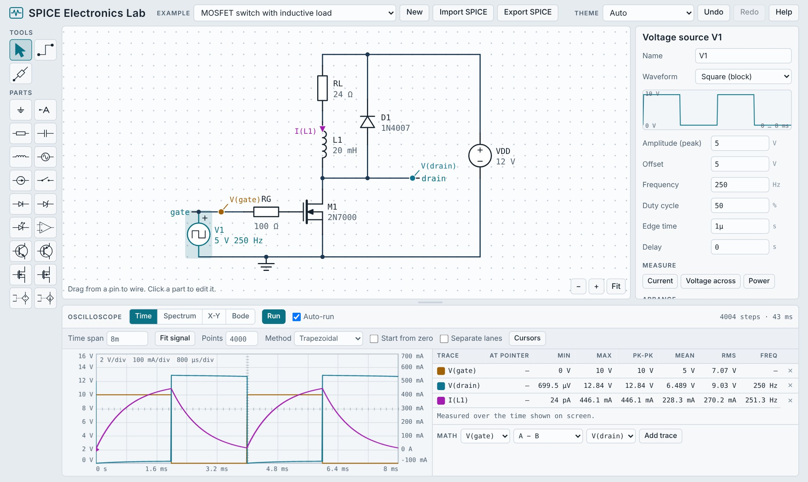
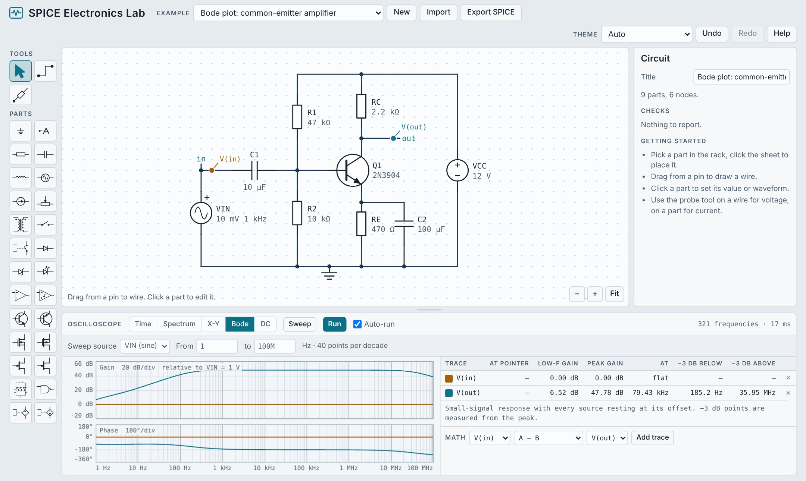
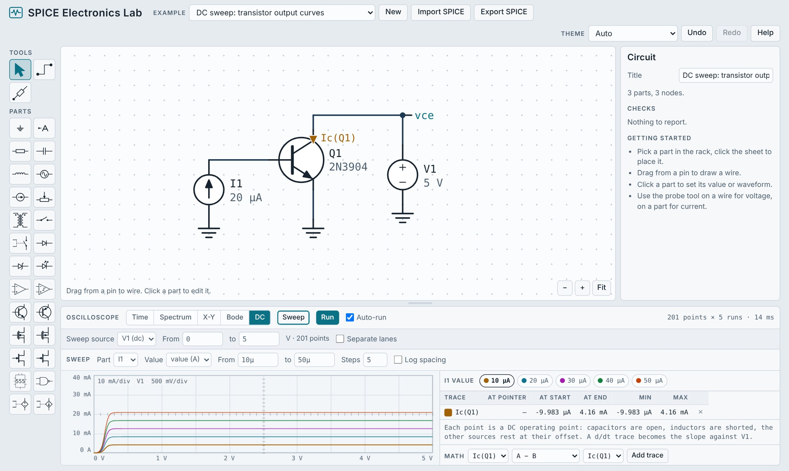
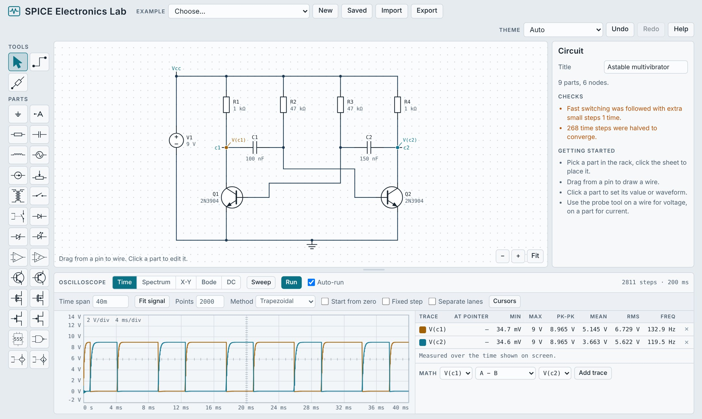

# SPICE Electronics Lab

An electronics bench in a single web page. Draw a circuit, drive it with a signal generator, probe any
node voltage or part current on an oscilloscope, read or write SPICE netlists, open LTspice
schematics as they were drawn, and take pictures and data out.

**Live demo:** <https://jurgenkobierczynski.com/SPICE_Electronics_Lab/SPICE_Electronics_Lab.html>

## Screenshot

The Bode view, showing the gain and phase of a common-emitter amplifier:

The DC view with a parameter sweep: collector current against collector voltage for five base currents:

An LTspice schematic opened in the lab, kept as it was drawn
([Astable_multivibrator.asc](Astable_multivibrator.asc)):

There is nothing to install or build. Open `SPICE_Electronics_Lab.html` in a browser, or put the file on
any web server. Everything runs in the browser; no data leaves the page.

## What it does

**Schematic editor**

- Parts: resistor, capacitor, inductor, potentiometer, transformer, voltage and current sources, switch
  (by hand or timed), voltage-controlled switch, diode, zener, LED, NPN and PNP transistors, N and P
  channel MOSFETs, N and P channel JFETs, op-amp, comparator, 555 timer, logic gates (NOT, buffer, AND,
  NAND, OR, NOR, XOR, XNOR), voltage-controlled voltage and current sources, ground and net labels.
- Place parts from the rack, drag from a pin to wire, drag parts to move them (wires follow), rotate,
  mirror, duplicate, undo and redo. Pan by dragging the sheet, zoom with the wheel.
- A transformer can be drawn with its secondary dot at the bottom, and a 555 timer as the 8-pin
  package with pins 1 to 8 in order (both as in LTspice).
- Values accept engineering notation: `4.7k`, `100n`, `2.2u`, `1M`, `1meg`.
- Themes: follows the system light or dark setting, or pick Lab Light, Lab Dark, Solarized Light,
  Solarized Dark, Nord, Catppuccin Latte or Catppuccin Mocha. The choice is remembered in the browser.

**Signal generator**

Every source can be DC, sine, square (block), triangle (zigzag), sawtooth, pulse, exponential, AM, FM,
noise or a piecewise-linear shape typed in as time/value points. A small preview shows the waveform
over the simulated time span.

**Oscilloscope**

- Probe tool: click a wire or pin for that node's voltage, click a part for the current through it.
  On a part with several pins, click near the pin whose current you want. "Voltage across" gives the
  difference between the two pins of a part, and "Power" gives voltage across times current.
- Math traces combine existing traces: difference, sum, product, ratio, derivative and integral.
- Five views of the same probes:
  - **Time:** voltages on the left axis, currents on the right, or one lane per trace. Per trace: value
    at the pointer, minimum, maximum, peak-to-peak, mean, RMS and frequency, measured over the time
    shown on screen. Two cursors give time and value differences. Scroll to zoom, drag to pan.
  - **Spectrum:** the FFT of the time span on screen, in decibels or linear amplitude, on a linear or
    logarithmic frequency axis. Per trace: DC level, fundamental frequency and amplitude, total
    harmonic distortion, and the 2nd and 3rd harmonics.
  - **X-Y:** every trace plotted against a chosen X trace, for device curves, hysteresis loops and
    Lissajous figures.
  - **Bode:** gain in decibels and phase against frequency, from an AC sweep of one source. Per trace:
    low-frequency gain, peak gain and its frequency, and the -3 dB points.
  - **DC:** every trace against the value of one source, stepped from one value to another. A
    derivative math trace becomes the slope of the curve: the gain of an inverter, the
    transconductance of a transistor.
- **Parameter sweep:** repeat the run for 2 to 12 values of one part (a resistance, a duty cycle, a
  model parameter, a wiper position) and see the runs drawn over each other in any view. With the DC
  view this gives families of curves.

**SPICE import and export**

- Export writes a standard netlist. The drawing is stored in comment lines starting with `*@`, which
  other simulators ignore, so an exported file comes back exactly as drawn.
- Import reads R, C, L, V, I, D, Q, M, J, S, E, G and X elements, a K coupling between two inductors
  (it becomes a transformer), `.model`, `.subckt` (expanded), `.param` and `{expressions}` (with
  `.func`, `if()`, comparisons and the usual functions; the tolerance functions `mc`, `gauss` and
  `flat` give the nominal value), `.tran`, `.ac`, `.dc`, `.step` of one value (it becomes a parameter
  sweep), and the sources DC, SIN, PULSE, PWL, EXP, SFFM and AM with an optional AC value. LTspice's
  forms are understood as well: `.tran` with only a stop time, `startup`, a maximum time step, VDMOS
  power MOSFET models, a PULSE with a cycle count of 1. A netlist without layout comments is drawn as a
  ladder: one vertical rail per node, parts in a column beside it.
- A file from another program gets enough points to follow every edge of its fastest pulse source.
- Elements that are not supported (transmission lines, behavioural sources, current-controlled
  sources, couplings between more than two inductors) are skipped and listed after import.
- How parts are written:
  - Square, triangle and sawtooth as PULSE, noise as PWL.
  - AM and FM as expression (B) sources. The order of the AM and SFFM arguments differs between
    LTspice, older ngspice and ngspice 42 or later, so an expression is the only form that every
    program reads the same way. On import both argument orders are recognised.
  - A potentiometer as two resistors, a transformer as two inductors with a K line and two loss
    resistors, a timed switch as a switch with its own pulse source.
  - The op-amp and the comparator as a small subcircuit of standard parts. The 555 timer and the
    logic gates as subcircuits that use switches and expression sources, which ngspice and LTspice
    understand.
- In SPICE files `M` means milli and `MEG` means mega; the lab reads and writes files that way, while
  its own value fields treat a capital `M` as mega.

**LTspice schematics**

Import an LTspice `.asc` file, or drop it on the page, and it arrives as drawn: the same wires, ground
symbols and net labels, with the lab's own part in the place of each LTspice symbol. Where a pin of the
lab's part sits elsewhere than the LTspice pin, a short wire is routed between them, around the other
parts; wire ends left over are trimmed.

- Recognised symbols: resistors, capacitors, inductors (two with a K line become a transformer, drawn
  with the secondary dot where LTspice has it), voltage and current sources (including battery, cell
  and signal), diodes, zeners, Schottky diodes, LEDs, NPN and PNP transistors, N and P channel MOSFETs
  (3 and 4 pin), N and P channel JFETs, the voltage-controlled switch, E and G sources, the NE555 (drawn
  as the package), the ideal `opamp`, `opamp2`, `UniversalOpamp2`, the op-amps and comparators of
  LTspice's library in their common pin layouts, and the digital AND, OR, XOR, buffer, inverter and
  Schmitt trigger when one output and at most two inputs are in use.
- Op-amps and comparators take their output limits from the supply rails, when those come from a DC
  source to ground. Gates take their logic level from `Vhigh`.
- LTspice's own model library is not in the file. Models whose names the lab knows (2N3904, 1N4148,
  2N7000 and the other presets) are used; for the rest typical values are filled in, a Zener's voltage
  taken from its name where it shows (BZX84C5V1), and each such part is listed in the import notes.
- Behavioural sources, current-controlled sources, transmission lines and symbols from other libraries
  are left out and listed.
- The symbol pin positions were taken from LTspice's library files. Before the drawing is shown, its
  connections are compared with a netlist worked out from the `.asc` file alone; if they differ, the
  circuit is laid out as a ladder instead and the notes say so.
- LTspice saves schematics as UTF-16 or Windows-1252 text; both are read, and so is UTF-8.

**Getting results out**

- **Export** offers four things: the SPICE netlist; a picture of the schematic; a picture of the
  scope view as it is set, with a title and a legend that names every trace (and every run of a
  parameter sweep); and the traces of the current view as a CSV table.
- Pictures are SVG, sharp at any size and editable in a drawing program, or PNG at twice screen
  resolution. They use the colours of the theme in use, so a dark theme gives dark pictures.
- The CSV table holds every point of the run, not only the part on screen: time and the traces for the
  Time and X-Y views, frequency and amplitudes for the Spectrum, frequency with gain and phase per trace
  for Bode, the swept value for DC. With a parameter sweep each run follows the one before, marked by a
  first column with the swept value. Numbers can be written with a decimal point and commas, or with a
  decimal comma and semicolons for spreadsheets set up that way.
- **Saved** keeps the circuit on the sheet in the browser under a name, as many as you like; saved
  circuits head the Example list and open from there. They stay in that browser on that device: use
  Export for a copy elsewhere. The circuit being worked on is also kept by itself and comes back when
  the page is opened again.

## Example labs

The Example menu holds 119 ready-made circuits, each with probes already placed and the scope set to
the view that shows the point:

- **First steps:** RC low-pass filter; Voltage divider; RC high-pass (differentiator); RL circuit: current build-up; Superposition of two sources; Transformer: turns ratio; Timed switch: charging and discharging a capacitor.
- **Bode plots:** Bode plot: twin-T notch filter; Bode plot: two-way loudspeaker crossover; Bode plot: op-amp band-pass filter; Bode plot: three RC sections; Bode plot: compensated 10× probe divider; Bode plot: RC low-pass; Bode plot: RC high-pass; Bode plot: RLC band-pass; Bode plot: LC filter with a resonance peak; Bode plot: impedance of a series RLC; Bode plot: Sallen-Key low-pass; Bode plot: op-amp integrator; Bode plot: op-amp gain and bandwidth; Bode plot: common-emitter amplifier; Bode plot: gain between two nodes (ratio trace); Bode plot: JFET amplifier; Bode plot: transformer bandwidth.
- **Spectrum:** Spectrum: mixing two tones in a diode; Spectrum: harmonics of a square wave; Spectrum: sine, square, triangle and sawtooth; Spectrum: AM carrier and sidebands; Spectrum: FM sidebands; Spectrum: two close tones; Spectrum: diode clipper distortion; Spectrum: half-wave rectifier; Spectrum: crossover distortion; Spectrum: op-amp clipping; Spectrum: noise before and after a filter; Spectrum: PWM before and after the LC filter; Spectrum: sampling and its images; Spectrum: pulse-width modulation.
- **X-Y plots:** X-Y: transistor output curve; X-Y: MOSFET transfer curve; X-Y: zener diode curve; X-Y: diode characteristic curve; X-Y: Schmitt trigger hysteresis; X-Y: Lissajous figure; X-Y: phase shift as an ellipse; X-Y: CMOS inverter transfer curve; X-Y: amplifier clipping; X-Y: crossover distortion.
- **DC sweeps:** DC sweep: transistor output curves; DC sweep: MOSFET output curves; DC sweep: MOSFET transfer curve and transconductance; DC sweep: CMOS inverter transfer curve and gain; DC sweep: zener regulator, output against input; DC sweep: diode current against voltage; DC sweep: op-amp transfer curve with clipping; DC sweep: JFET transfer curve and transconductance.
- **Parameter sweeps:** Sweep: a potentiometer as a volume control; Sweep: the time constant of an RC filter; Sweep: damping of a series RLC circuit; Sweep: the Q of a band-pass filter (Bode); Sweep: op-amp gain against bandwidth (Bode); Sweep: PWM duty cycle to output voltage; Sweep: emitter resistor and amplifier gain (Bode); Sweep: 555 frequency set by the timing resistor.
- **Power and math:** Power in a resistor and a capacitor; Power: real and reactive power in an RL circuit; Power: buck converter input and output; Power: dissipation in a switching MOSFET; Math trace: charge from current; Math trace: energy stored in a capacitor; Math trace: slope of a capacitor voltage; Math trace: differential output.
- **Signals:** Signal shapes: sine, square, triangle, sawtooth; Signal shapes: pulse, exponential, FM, noise; Beats from two close frequencies; Ideal amplifier from a controlled source; Sample and hold with a voltage-controlled switch.
- **Resonance and filters:** Series RLC step response; LC tank ringing down; RLC band-pass with a frequency sweep; Noise through a low-pass filter; PWM smoothed by an LC filter; Sallen-Key low-pass filter.
- **Diodes:** Bridge rectifier with smoothing; AM envelope detector; Half-wave rectifier; Zener voltage regulator; Diode clipper; Diode clamper (DC restorer); Voltage doubler; LED and series resistor; Mains transformer, bridge rectifier and smoothing.
- **Transistors:** Common-emitter amplifier; Emitter follower; Transistor switch driving an LED; Current mirror; Differential pair; Push-pull output stage (crossover distortion); Astable multivibrator; CMOS inverter; JFET common-source amplifier.
- **Op-amps:** Op-amp inverting amplifier; Op-amp relaxation oscillator; Op-amp non-inverting amplifier; Op-amp summing amplifier (mixer); Op-amp integrator; Schmitt trigger; Precision rectifier; Wien bridge oscillator; Comparator as a pulse-width modulator.
- **Timers and logic:** 555 timer as an oscillator (astable); 555 timer as a one-shot (monostable); Logic gates: AND, OR and XOR; Set-reset latch from two NOR gates; Ring oscillator from three inverters.
- **Power and switching:** MOSFET switch with inductive load; Buck converter (step-down); Boost converter (step-up); Switching off a coil: the flyback diode.

Every example is an ordinary circuit: edit it, re-probe it, save it under your own name, or export it.

## Keyboard

| Key | Action |
| --- | --- |
| `W` | Wire tool |
| `P` | Probe tool |
| `Esc` | Back to select, end a wire |
| `R` | Rotate the selection or the part being placed |
| `X`, `Y` | Mirror horizontally, vertically |
| `Del` | Delete the selection |
| `Ctrl`+`D` | Duplicate |
| `Ctrl`+`Z`, `Ctrl`+`Y` | Undo, redo |
| `Ctrl`+`A` | Select all |
| `Shift`+drag | Select an area; `Shift`+click places several parts in a row |

## How it simulates

Transient analysis by modified nodal analysis: a DC operating point (Newton iteration, with gmin
stepping, source stepping and a settle-from-zero fallback), then time steps with the trapezoidal rule
or Backward Euler and Newton iteration at every step. A circuit for which no operating point can be
found at all (some oscillators and latches) starts from zero instead, as if switched on.

The time step is error-controlled. The number of points sets the longest step; wherever the estimated
error of a step is larger than the tolerance (relative 0.1 %, as in SPICE), the step is repeated
with a shorter one and the extra points are kept. Steps land on the corners of every source waveform,
and the first step after a corner is taken twice, whole and in two halves, so that it can be judged as
well. "Fixed step" switches this off and takes exactly one step per point.

Parts with a state (the 555 timer, switches) change state at the moment their input crosses the
threshold: that moment is located inside the step, so timing does not depend on the number of points.
Fast positive-feedback switching (Schmitt triggers, multivibrators, latches) is detected and followed
with extra small steps; where Newton iteration still fails, the step is halved, down to picoseconds
if needed, so that even the snap of a fast transistor pair in a slow circuit is followed.

AC analysis for the Bode view linearises the circuit at its operating point, with every source resting
at its offset, and solves the complex equations at 40 frequencies per decade. The DC sweep finds one
operating point per value of the swept source, each starting from the one before. Exported netlists
carry the matching `.ac` and `.dc` lines and `DC` and `AC` values on the sources.

Device models:

- Diode: Shockley equation with reverse breakdown and junction capacitance.
- Bipolar transistor: Ebers-Moll transport model with junction capacitances.
- MOSFET: level 1 square law with channel-length modulation and constant gate capacitances; the bulk
  is tied to the source, and the body diode between source and drain conducts when the drain is
  driven the wrong way round, as in SPICE.
- JFET: Shichman-Hodges square law with gate junctions and their capacitances.
- Junction capacitances follow the voltage across the junction, with the SPICE formula. When a
  transistor model gives no capacitance, a small one is assumed (5 pF and 3 pF for a bipolar
  transistor, 2 pF and 0.5 pF for a MOSFET of default width) and written into the exported model.
- Op-amp and comparator: finite gain, one pole set by the gain-bandwidth product, output held between
  two limits.
- Transformer: two coupled inductors. Each winding has a loss resistance in parallel, equal to its
  reactance at 100 kHz, which damps the ringing of the leakage inductance. A transformer imported from
  a K line has none.
- 555 timer: the 5 kΩ divider, two ideal comparators, a latch with trigger priority, an output stage
  with 10 Ω output resistance that reaches 1.5 V below the supply, and a 10 Ω discharge switch.
- Logic gates: a smooth transfer curve around half the logic level, a delay, an output resistance. No
  supply pins; inputs draw no current.

## Checked against ngspice

Every example was exported as a netlist, run in ngspice 45.2 and compared with the lab's own result at
every probed node. ngspice ran as the WebAssembly build from the `eecircuit-engine` package.

- Transient: 118 of the 119 examples agree within 2 % of the signal's span, the other within 5 %.
  That one is a relay coil with a flyback diode, where the two programs resolve the ringing after the
  switching edge slightly differently. Free-running oscillators are compared by
  frequency and swing, because their phase is arbitrary.
- AC: all 20 examples with a Bode view agree within 0.01 dB and 0.1 degree.
- DC sweep: all 8 examples with a DC view agree within 0.1 %.
- Twenty more circuits that exercise each of the newer parts (JFETs, transformer, potentiometer,
  switches, comparator, 555 timer, logic gates, AM and FM sources) agree within 2 %.

Two things the comparison showed that are worth knowing when you take a netlist to ngspice:

- With ngspice's default trapezoidal integration the astable multivibrator's waveform carries ringing,
  which a frequency measurement reads as about twice the true value. With `.options method=gear`
  ngspice gives 1.49 kHz, the same as the lab.
- ngspice's switch with hysteresis can lose its state when its control voltage comes from an
  expression source, so the exported 555 timer keeps its state on a capacitor instead.

The LTspice import was tried on the 131 schematics of a public collection
([mick001/Circuits-LTSpice](https://github.com/mick001/Circuits-LTSpice)) and on the test files of the
spicelib project, which come with the netlists LTspice made from them. All 131 open as drawn, and
where LTspice's netlist is at hand the connections match it. Run in ngspice, 101 of them agree within
2 % and 2 more within 5 %. Most of the rest are circuits with two stable states (latches, Schmitt
triggers, thyristor pairs) that the two programs settle differently at the start, circuits on which
ngspice itself gives up, and nodes that float. Three do not run here: two take longer than the 10 s
limit, and one ties two comparator outputs together. LTspice itself was not run.

## Limits

- Transient, AC and DC sweep analysis. No noise analysis, no temperature sweep.
- The Bode view is small-signal: clipping, switching and other large-signal effects do not show in it.
- The spectrum is computed from the simulated points, so the solver's own error sets its noise floor
  (typically 60 to 80 dB below the signal). More points lower it.
- The semiconductor models leave out series resistance, charge storage, the Early effect and
  temperature. The part presets (1N4148, 2N3904, 2N7000, 2N5457 and others) use typical published
  parameter values and are not manufacturer models.
- The 555 timer, the comparator and the logic gates are behavioural: they have no supply current of
  their own beyond the timer's divider, no input current, and no limits on output current other than
  their output resistance.
- A DC sweep follows one branch of a circuit with hysteresis (it sweeps upwards only).
- A parameter sweep steps one value. A `.step` of one parameter that sets one value is read as a
  sweep; nested sweeps are not supported. The sweep is stored in the layout comments.
- From LTspice schematics only the symbols listed above are read, and LTspice's own model library is
  not available, so its parts get typical values unless the file defines them.
- The page handles circuits up to 400 unknowns and stops a run after 10 seconds.

## Relation to SPICE

This is an independent implementation written from the published methods. It contains no code from
Berkeley SPICE, ngspice or any other simulator; it only reads and writes the SPICE netlist format.
ngspice was used as a reference to compare results with, not as a source.

The page loads the Barlow and IBM Plex Mono typefaces from Google Fonts when online and falls back to
system fonts otherwise.

## Licence

Copyright (C) 2026 Jurgen Kobierczynski

This program is free software: you can redistribute it and/or modify it under the terms of the GNU
General Public License as published by the Free Software Foundation, version 3. It is distributed in
the hope that it will be useful, but WITHOUT ANY WARRANTY; without even the implied warranty of
MERCHANTABILITY or FITNESS FOR A PARTICULAR PURPOSE. See [LICENSE](LICENSE) for the full text.

## Attribution

Designed and written with Claude Opus 5.5 Medium (Anthropic), directed by Jurgen Kobierczynski.
